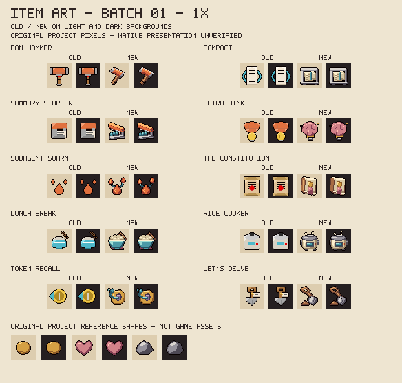

# Item art batch 01

Ten original 32x32 collectible icons replace their deterministic placeholders, starting from source 7e91788. This is a source-art delivery with offline visual review, not owner approval of a character identity or native pickup acceptance. All item names, effects, charge values, qualities, pools and costume behavior remain unchanged. Installed 8fd6a8c is preserved and still owner-untried.

## Before and after

The old columns reproduce the prior placeholder code; the new columns reproduce the committed drawing functions. Each appears on both light and dark fields. The bottom examples are newly drawn project reference shapes, not extracted game icons. Text is outside the icon pixels.



[Open the nearest-neighbour 4x review sheet](art/item-batch-01-4x.png).

## Visual decisions

| Item | Existing effect / meme cue | New original object drawing |
|---|---|---|
| Ban Hammer | Bans regular enemies and damages bosses. | Heavy diagonal orange gavel, steel end caps and a wrapped wooden handle. Bright upper face separates from the darker lower edge. |
| Compact | Compacts context, clears projectiles and confuses enemies. | A compressed paper block inside an iron press; cyan binding and layered paper distinguish it from the stapler. |
| Summary Stapler | Bundles nearby ordinary bullets into one stronger shot. | An open orange stapler with its hinge at the rear and three blue projectile capsules between the jaws. |
| Ultrathink | Escalating room-local thought bonuses. | Folded pink brain on a brass bulb base, with small sparks; removes the old letter-like bulb mark. |
| Subagent Swarm | One primary tear produces two resolved child tears. | A large orange tear branches to two smaller tears along blue trails. Different sizes communicate the parent/child relationship. |
| The Constitution | Protective rules, a shielded hit and a stat tradeoff. | A thick cream rulebook, leather spine, embossed shield and hanging wax seal; no text or company emblem. |
| Lunch Break | Healing food break with a shooting lockout. | Turquoise rice bowl with grain highlights, chopsticks and a small folded napkin; visibly food rather than a flat blue flask. |
| Rice Cooker | Cooking lockout followed by a primed attack, without healing. | Cream enamel cooker with a steel lid, steam, side handles and a blue window. It remains distinct from the edible bowl. |
| Token Recall | Retrieves owner tears and grants temporary projectile guards. | Brass reel pulling a blue tear along a curved tether; removes the old digit-like central slot. |
| Let's Delve | Delegates the native digging effect. | A diagonal spade with an open wooden grip, bevelled steel blade and small soil clod. |

The review checked actual-size recognition, silhouette differences, hard outline, top-left material lighting, transparent margin, excessive dark mass, incidental text/logos and contrast on both fields. The stapler's upper lever was revised during review to make the opening and rear hinge read more clearly. Deliberate asymmetry belongs to the object pose, not a new player-body or portrait design.

## Source, terms and reproduction

Drawing functions and declared palettes are in [make_item_art.py](../tools/make_item_art.py), with per-icon metadata and exact SHA-256 in [item-art-manifest.json](item-art-manifest.json). All new icon geometry, shading, review lettering and reference shapes are original project code, Codex-assisted, under the project MIT terms. No native sprites, unlicensed references, official logos or character-design pixels are copied into this batch. Existing character design credits and non-commercial terms remain unchanged in [ART_LICENSE.md](../resources/ART_LICENSE.md).

```sh
python tools/preview_item_art.py --write
python tools/make_item_art.py --write
python tools/make_item_art.py --check
python tools/preview_item_art.py --check
bash tools/check.sh
```

The preview producer uses only the standard library and an original bitmap alphabet. Generate the sheets before regenerating icons because designed records require their contact-sheet path to exist. --check verifies committed pixels rather than refreshing hashes. Both 1x and 4x sheets are checked for exact reproducibility by the asset gate.

## Evidence and remaining work

- Exactly ten existing PNGs differ from 7e91788; the other 163 existing PNGs are byte-identical, including the remaining 82 item icons and every character/menu image. All 25 animation files remain identical after Git line-ending normalization. Two review PNGs are added, bringing the complete art inventory to 200 files.
- All ten replacements pass the 32x32 RGBA8, hard-alpha, transparent-margin and declared-palette contracts. They use 7-13 visible colours; no palette exception is needed. The registry now contains ten designed and 82 placeholder icons.
- The existing full gate passes 69 Lua suites, 11 scanner cases, 13 item-art regression groups and XML/assets/poses/report checks, plus exact review-sheet reproduction. The missing-producer regression explicitly injects an empty design map so it remains a genuine missing-producer case after real definitions are added.
- Native pedestal scale, pickup animation, EID layout and dark/special-room presentation remain untested. This batch does not close the oversized-hurt-head report or any character/mechanism completion row. No installation, game launch, input, settings/save access or Workshop publication occurs.

Continue the remaining icons in focused batches, interleaving confirmed W3 compatibility and W6 state/performance work. Preserve owner-selected character identities and the manual-test installation.
