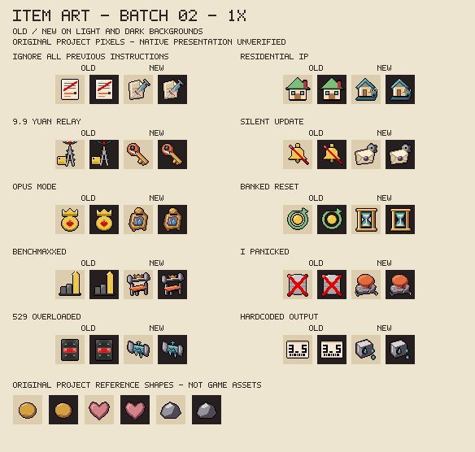

# Item art batch 02

Eight collectible and two trinket icons receive original 32x32 pixel drawings from source c22310f, reviewed offline on 2026-10-27. This brings the registry to 20 designed icons and 72 placeholders. Item names, effects, charge values, quality, pools and all character artwork remain unchanged. Installed 8fd6a8c stays owner-untried and preserved.

## Before and after

The old columns reproduce the legacy placeholders; the new columns reproduce the committed drawing code. Each is shown on light and dark fields. The bottom reference shapes are original project pixels, not extracted game assets. Labels remain outside the icons.



[Open the nearest-neighbour 4x sheet](art/item-batch-02-4x.png).

## Visual decisions

| Item | Existing mechanic | Original object drawing |
|---|---|---|
| Ignore All Previous Instructions | Charms an eligible regular target or briefly confuses a boss. | A pink-fluid syringe crossing a folded cream instruction sheet: an injection of new orders, without printed text. |
| Residential IP | Reduces shared Claude risk and slows positive increases; does not enable DeepSeek risk. | A small cream cottage, blue roof and protected cable ending in a plug. House and connector communicate residential access. |
| 9.9 Yuan Relay | Cheap access boosts damage but can substitute a weaker model each room. | A worn brass key with a cracked orange bow patched with tape. Two protruding teeth keep it readable as a key. |
| Silent Update | Quietly changes the saved damage multiplier on each floor. | A sealed cream envelope concealing a steel gear, with a purple wax seal. The mechanism is partly hidden, not a visible changelog. |
| Opus Mode | Coin-funded damage boost; falling back when the wallet is empty. | An ornate brass coin meter, purple inset and blue tear dial, with a coin entering the upper slot. |
| Banked Reset | Clears normal-Claude Usage/Limited, refills tainted Quota and reduces risk. | A blue-glass hourglass and pale sand inside brass vault rails: a reset kept for later. No new timer mechanic is implied. |
| Benchmaxxed | Stronger in boss/miniboss/challenge/Boss Rush rooms, weaker elsewhere. | A red padded weight bench and loaded steel bar, with a small brass crown suggesting boss benchmarks. |
| I Panicked | Damages enemies and deletes eligible loose consumables. | A broad emergency plunger on a cracked steel base with severed leads. The action is visibly destructive without a written warning. |
| 529 Overloaded | Periodic enemy freeze and reduced holder tear damage during the outage. | A broken glass fuse with cold shards between metal caps. No error-code digits are drawn. |
| Hardcoded Output | Assigns a fixed tear-damage value at its callback; later writers may still modify it. | A bevelled steel tear die beside two identical blue outputs, replacing the old numeric display. |

The first review made the relay key's teeth protrude beyond its shaft and moved the hidden gear higher to expose its teeth and centre. Final 1x and 4x sheets were inspected on both backgrounds for object recognition, outline weight, light direction, material contrast, spacing and accidental typography. This records an offline art review, not owner aesthetic approval or native rendering acceptance.

## Reproduction and evidence

Drawing code and the [registry](item-art-manifest.json) identify each original shape, palette, version, author/provenance and contact sheet. These original item pixels use the project MIT terms in [ART_LICENSE.md](../resources/ART_LICENSE.md); existing character-design terms stay separate. No company logos, imported art or private/native reference pixels are included.

```sh
python tools/preview_item_art.py --write --batch 02
python tools/make_item_art.py --write
python tools/make_item_art.py --check
python tools/preview_item_art.py --check
bash tools/check.sh
```

The preview tool accepts a selected batch; its default checks or writes all registered review batches. Batch 01 remains byte-identical, including both sheets. New designed records need their contact sheet before icon generation.

- Exactly ten existing icon PNGs change from c22310f. The other 165 existing PNGs, including all ten first-batch icons and both first-batch sheets, remain byte-identical. All 25 ANM2 files retain canonical content after Git line-ending normalization.
- Two new sheets bring the complete tracked art inventory to 202 files: 177 PNGs and 25 ANM2. All 92 registered icons remain present, with 18 designed collectibles and two designed trinkets.
- Every replacement passes hard-alpha, 32x32 RGBA8, transparent-margin, declared-palette and deterministic-byte checks. The complete gate retains 70 Lua suites, 11 scanner cases and 13 item-art regression groups; no gameplay expectation changes.
- Native pedestal/EID rendering, room lighting, pickup animation and the character hurt report remain unverified. This batch does not close mechanism or character completion rows. No installation, game/input/settings/save access or Workshop publication occurs.

Next: focused W3 compatibility findings and measured W6 performance, then more icons. Distinct tainted identities and selected character-look replacements still require their own previews and approval.
