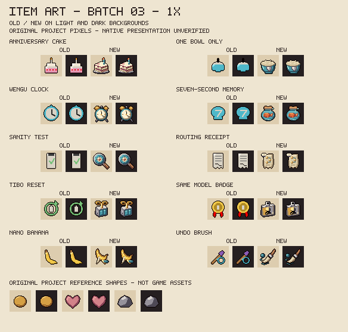
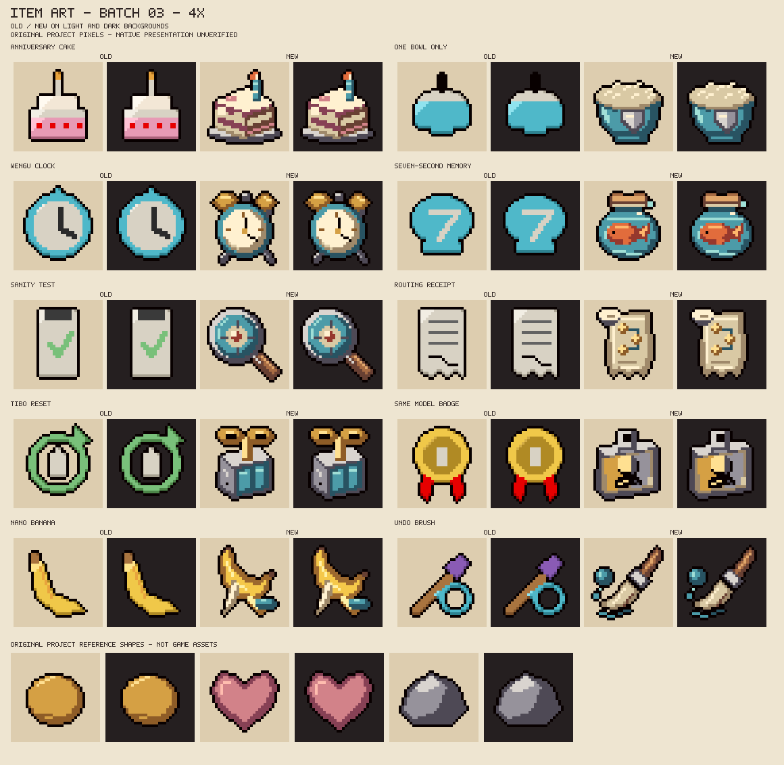

# Designed item icons: batch 03

Ten existing collectibles receive original pixel drawings on 2026-10-27. This batch follows the actual Claude/DeepSeek/GPT/Gemini item modules, without changing their effects, names, charge, quality, pools or registered paths. The registry now contains **30 designed icons and 62 placeholders**: 28 designed collectibles and two designed trinkets. All character artwork and earlier batches remain unchanged.

## Review sheets and visual intent





Each row shows the old and new icon on light and dark fields. The coin, heart and stone below are original project scale/material examples, not extracted game assets. Names sit outside icon pixels; no letters, numbers or official logos occur inside the new drawings.

| Item | Existing source effect | Drawing and distinguishing cue |
|---|---|---|
| Anniversary Cake | An eligible unspoiled floor adds damage; a spoiled floor resets this item's bonus. | A layered cake slice on a steel plate, pale icing and one lit candle. |
| One Bowl Only | The first consumed red-heart pickup in an eligible room can grant one ordinary-bullet guard, within the floor cap. | A deep rice bowl bearing a steel shield. Its front-facing guard and lack of chopsticks/napkin distinguish it from Lunch Break. |
| Wengu Clock | A six-second window rewards two seconds without attacking with a primed next attack. | A blue alarm clock, brass bells, plain hands and an unnumbered cream dial. |
| Seven-Second Memory | Mark an enemy on the first paid attack; a different attack hitting it within the window produces an extra pulse, then cooldown. | An orange fish in a rounded blue glass jar with a cork and bubbles. This is a fictional short-memory visual cue, not a factual claim about fish. |
| Sanity Test | Mark the nearest eligible target; three distinct attacks within the window trigger a pulse. | A steel magnifying glass surrounding a coloured target in blue glass. |
| Routing Receipt | Bank a damage bonus after three unique combat clears for a later combat room. | A rolled cream receipt with three brass punch points joined by a route, without printed text. |
| Tibo Reset | Once per floor, grant a temporary bonus for the next two new combat rooms; it resets no world or active-item state. | A twin-cell blue power pack with a brass winding key. It differs from Banked Reset's hourglass and Token Recall's reel. |
| Same Model Badge | A short stronger phase followed by a weaker phase, then baseline, in hostile rooms. | A clipped identity badge with one portrait divided into bright brass and dull steel, with a worn corner. |
| Nano Banana | Paint an enemy; its death within the window leaves a temporary slowing peel. | A curled yellow banana with separated peel tips and a small paint spot. |
| Undo Brush | Erase nearby ordinary hostile bullets for a temporary speed bonus. | A broad diagonal brush, pale bristles and a swept blue trail beside a breaking projectile. |

The 1x/4x sheets were visually inspected for object recognition, exterior outline, material separation, light direction and unintended typography. The first pass made Nano Banana too close to brass; a separate yellow fruit ramp improves the distinction. The candle flame was changed from pink to warm orange. Both final sheets were then reviewed again. These are offline visual observations, not owner aesthetic approval or native presentation acceptance.

## Reproduction and scope

```sh
python tools/preview_item_art.py --write --batch 03
python tools/make_item_art.py --write
python tools/make_item_art.py --check
python tools/preview_item_art.py --check
bash tools/check.sh
```

The [drawing producer](../tools/make_item_art.py) and [registry](item-art-manifest.json) record original geometry, material palettes, versions, provenance, hashes and the contact sheet. New designed records require the sheet before generation. The shared preview tool includes batch 03; the default checks all six sheets.

- Exactly ten existing PNGs change against `81b9976`; all other 167 existing PNGs, including all earlier designed icons and four sheets, retain their bytes. All 25 ANM2 files retain canonical content after Git EOL normalization.
- Two new sheets bring the complete linked art inventory to 204 files: 179 PNGs and 25 ANM2. The 92 registered icon paths and all gameplay Lua, tests, XML and pool metadata remain unchanged.
- Every replacement passes 32x32 RGBA8, hard-alpha, transparent outer margin, declared-palette and deterministic-byte checks. The full gate retains 70 Lua suites, 11 scanner cases and 13 item-art groups, alongside XML, character geometry, all six sheets and report freshness.
- These drawings and review sheets are original project contributions under the [item-art MIT terms](../resources/ART_LICENSE.md). No third-party pixels, native references or private images are published. Character-design terms remain separate.

Native pedestal/EID rendering, lighting and pickup presentation remain pending. All 97 item and 22 character completion rows stay open. Installed `8fd6a8c` remains owner-untried and untouched; no game, settings or saves were accessed. Next: focused W3 compatibility findings and scheduled hardening, then more icon batches. Workshop remains unauthorized.
