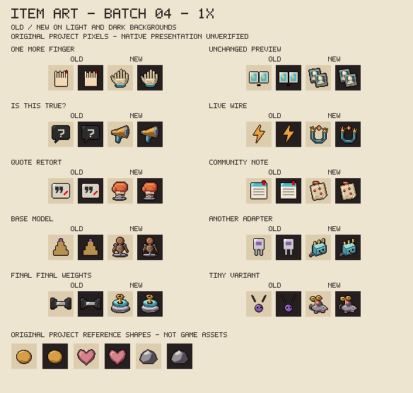
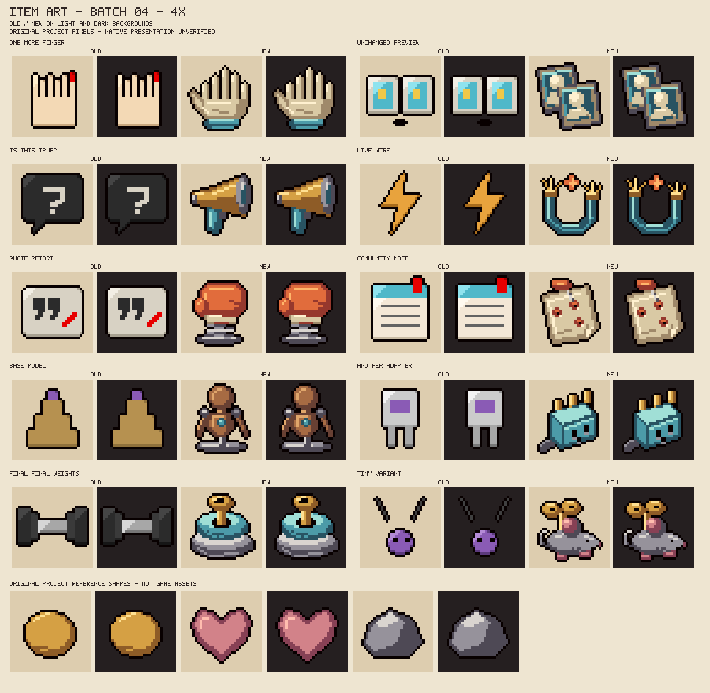

# Designed item icons: batch 04

Ten existing Gemini/Grok/Qwen collectibles receive original pixel drawings on 2026-10-27. This batch changes artwork and its records only. The 92-icon registry now contains **40 designed icons and 52 placeholders**: 38 designed collectibles and two designed trinkets. Native presentation and owner aesthetic acceptance remain pending.

## Review sheets and meaning





Each row shows the old and new icon on light and dark backgrounds. The coin, heart and stone below are original project examples, not extracted native assets. Labels are outside the icon pixels; the new drawings contain no letters, digits, official logos or imported artwork.

| Item | Existing source effect | Drawing and distinguishing cue |
|---|---|---|
| One More Finger | Adds one small derived tear after every fifth eligible attack, subject to its cooldown. | A cream glove with five upright fingers and a side thumb: six digits intentionally, with a blue cuff. |
| Unchanged Preview | Creates two temporary decoy markers and replaces the owner's prior pair. | Two overlapping blue slide frames containing the same faceless bust. |
| Is This True? | Challenges one target: increased damage to it, reduced damage elsewhere, and a conditional charge return. | A brass megaphone with a deep mouth and blue grip, issuing a challenge without a question-mark icon. |
| Live Wire | Adds speed while an ordinary hostile bullet is nearby. | A blue cable loop, exposed copper strands and one orange spark; the physical wire replaces a generic lightning glyph. |
| Quote Retort | A qualifying player-hit event primes the next attack within its window. | An orange boxing glove on a compressed steel spring, with an ivory cuff and a side fold. |
| Community Note | Three distinct attacks expose a target for a temporary damage multiplier, within the room limit. | A pinned evidence note with three punctures and a folded corner, without handwriting. |
| Base Model | The first common charged-use observation in a room primes an attack; the F12 observer ambiguity remains open. | An unfinished wooden training mannequin on a steel stand, with a blue chest socket. |
| Another Adapter | Cycles among three room bonuses; each use replaces the current bonus. | An angled blue adapter block with three brass contacts, a socket face and a short cable. |
| Final Final Weights | Two unique flawless clears bank a damage bonus for a later hostile room. | Two stacked metal weight plates secured by a brass locking ring, without printed numbers. |
| Tiny Variant | Adds speed and reduces damage through the cache; it does not resize the player. | A small clockwork mouse with a large winding key and pink feet, distinct from the wooden Base Model. |

The 1x/4x sheets were inspected at their original resolution for silhouette recognition, outline, material separation, light direction and accidental typography. The first glove's fingers were too narrow and rigid; wider rounded tips improve the six-digit reading. Two vertical boxing-glove creases looked like eyes, so one side fold replaced them. Both final sheets were inspected again. These observations do not establish native pedestal/EID appearance or owner approval.

## Reproduction and boundaries

```sh
python tools/preview_item_art.py --write --batch 04
python tools/make_item_art.py --write
python tools/make_item_art.py --check
python tools/preview_item_art.py --check
bash tools/check.sh
```

The [drawing producer](../tools/make_item_art.py) and [registry](item-art-manifest.json) record geometry, palette, drawing version, provenance, meaning, output hash and the contact sheet. The preview tool adds batch 04 and a question-mark label glyph; all earlier drawing functions and sheets retain their content. Its default comparison now covers eight sheets.

- Exactly ten existing PNGs change against `d0f4117`. All other 169 existing PNGs, including the previous designed icons and six sheets, retain their bytes. All 25 ANM2 files retain canonical content after Git EOL normalization.
- Two new sheets bring the linked art inventory to 206 files: 181 PNGs and 25 ANM2 files. The other 82 registry entries, all production Lua, tests, XML, pools and character identities are unchanged.
- All ten icons pass 32x32 RGBA8, hard-alpha, transparent-margin, declared-palette and deterministic-byte checks. The full gate retains 70 Lua suites, 11 scanner cases, 13 item-art groups and six thumbnail groups, plus character/pose, XML, eight-sheet and interaction-report checks.
- Current inventory subtotals are reconciled to 38 designed/42 placeholder collectibles and two designed/ten placeholder trinkets. The prior current collectible subtotal had not incorporated batch 03; dated batch evidence retains its original scope.
- Drawings and review sheets use the [original-item MIT terms](../resources/ART_LICENSE.md). Character-design credits and non-commercial conditions remain separate. No private reference files or external pixels are published.

All 97 item and 22 character completion rows remain open. Installed `8fd6a8c` is owner-untried and preserved; no runtime, game, settings or saves are accessed. Next: a focused W2/W4 gap, independent W3 findings and scheduled hardening. Workshop remains unauthorized.
