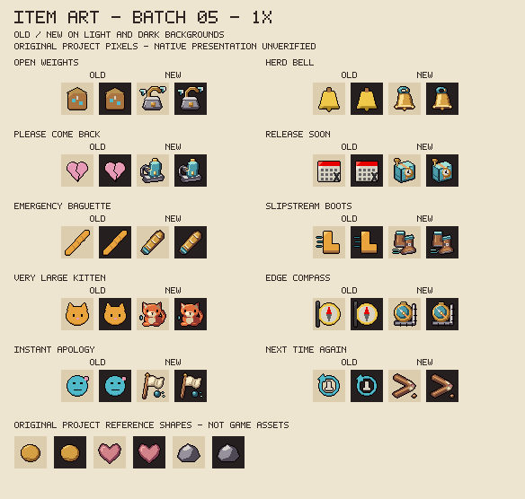
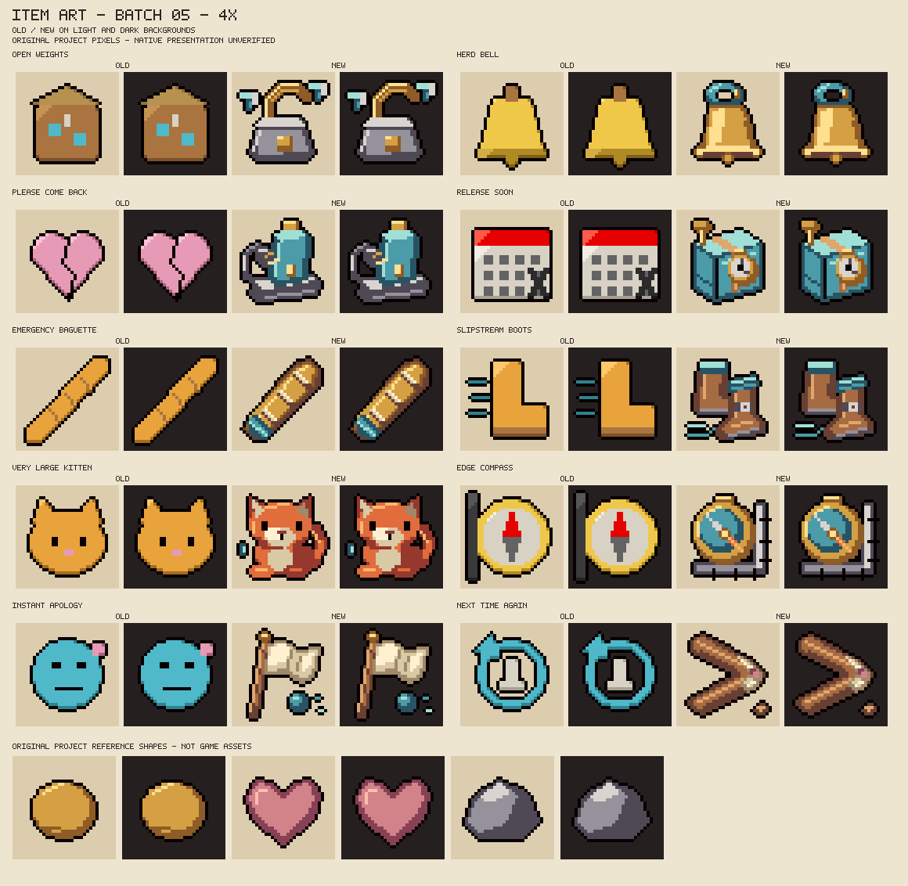

# Designed item icons: batch 05

Ten existing Llama/Mistral/Doubao collectibles receive original pixel drawings on 2026-10-27. The 92-icon registry now contains **50 designed icons and 42 placeholders**: 48 designed collectibles and two designed trinkets. This batch changes icons and their records, without adding items or changing effects. Native presentation and owner aesthetic acceptance remain pending.

## Review sheets and meaning





Each row compares old/new art on light and dark fields. The coin, heart and stone are original project reference shapes, not extracted game assets. All text stays outside the icon pixels. No letters, digits, official logos, imported pixels or character-design replacements are added.

| Item | Existing effect | Drawing and distinguishing cue |
|---|---|---|
| Open Weights | Gives native blue flies to living recipients; solo gets four, co-op gets two each for up to four recipients. | An unlocked iron weight with an open brass shackle and two small escaping blue flies. It is distinct from Final Final Weights' stacked plates; the drawing does not specify the actual recipient count. |
| Herd Bell | Without an owned blue fly, every third unique clear supplies one. | A polished brass cowbell with a blue leather loop, dark mouth and hanging clapper. Native fly movement stays unchanged; the old gather-closer idea is not implemented. |
| Please Come Back | Three unique clears without an observed charged use can add one eligible primary charge. | A blue battery standing in a steel charging cradle, with a loose plug and looping lead. The F12 completion-observer gap remains open. |
| Release Soon | Schedules three ordinary-bullet guards after two seconds, lasting six more seconds; leaving cancels pending work. | A strapped blue parcel with a brass timer and winding key, without clock numerals. It suggests delay rather than an explosion. |
| Emergency Baguette | A forward line strike, stopped by walls/obstacles, applies one x3 owner-damage hit per eligible enemy. | A long baked loaf with pale diagonal scoring and a blue cloth grip. This collectible remains separate from tainted Mistral's intrinsic ability. |
| Slipstream Boots | Sustained movement adds speed; a sharp turn can leave a slowing gust. | Overlapping brown ankle boots with blue cuffs, a metal buckle and a short air trail. No wings or implied flight. |
| Very Large Kitten | A stationary marker pushes nearby ordinary bullets during its lifetime. | A seated orange kitten with broad paws, a curled tail and a small blue projectile beside it. This is the item icon; the in-room marker still has no bespoke kitten entity sprite. |
| Edge Compass | Adds shot speed near the room's outer bounding-box edges. | A brass compass with a coloured needle beside a stone corner. No directional letters or map reveal are implied. |
| Instant Apology | Slows nearby enemies and removes up to four ordinary bullets; no healing or hit reversal. | A folded white truce flag over a dispersing blue projectile. It uses no heart or medical symbol. |
| Next Time Again | The first qualifying enemy hit in a room primes one attack for four seconds. | A chipped wooden boomerang with repair tape and a bruise-coloured patch, suggesting retaliation. It does not add a boomerang projectile mechanic. |

Both 1x/4x sheets were viewed at their original resolution. The initial loaf was too yellow and its small marks read as spots, making it resemble a glowing stick; a baked brass/brown ramp and larger pale cuts improve its bread reading. The original boomerang bend was too shallow and was redrawn with a clear return angle. The right fly was moved away from the weight body to keep the shackle visibly open. Both final sheets were viewed again. This is offline visual review, not owner approval or native appearance acceptance.

## Reproduction and boundaries

```sh
python tools/preview_item_art.py --write --batch 05
python tools/make_item_art.py --write
python tools/make_item_art.py --check
python tools/preview_item_art.py --check
bash tools/check.sh
```

The change replaces exactly ten existing PNGs against `d954109`. The other 171 PNGs and all 25 canonical ANM2 files remain unchanged. Two review sheets bring the linked art inventory to 208 files. The other 82 registry entries, existing drawing/preview functions, every Lua module/test and XML registration retain their previous content. No validator is relaxed and the label alphabet is unchanged.

The full gate retains 71 Lua suites, 11 Python scanner cases, 13 item-art groups and six thumbnail groups, with 188 tracked Lua files, XML/assets/poses, interaction freshness and now all ten art review sheets. New drawings/code use the original project MIT terms in [ART_LICENSE.md](../resources/ART_LICENSE.md). Character non-commercial credits and selected identities are unchanged. No source references or private files are uploaded.

Installed `8fd6a8c` remains owner-untried and preserved; no runtime, game, settings or saves are accessed. All 22 form rows and 97 item rows remain open. Native pickup/pedestal/EID rendering, lighting and item-effect compatibility still need observation. This icon batch does not establish native mechanic acceptance or Workshop authorization.
