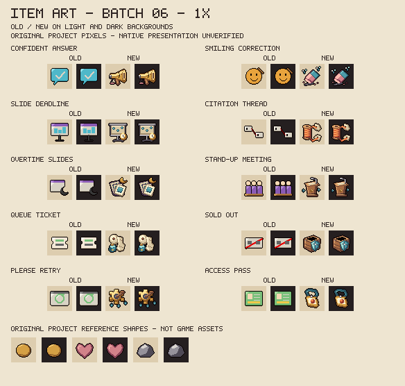
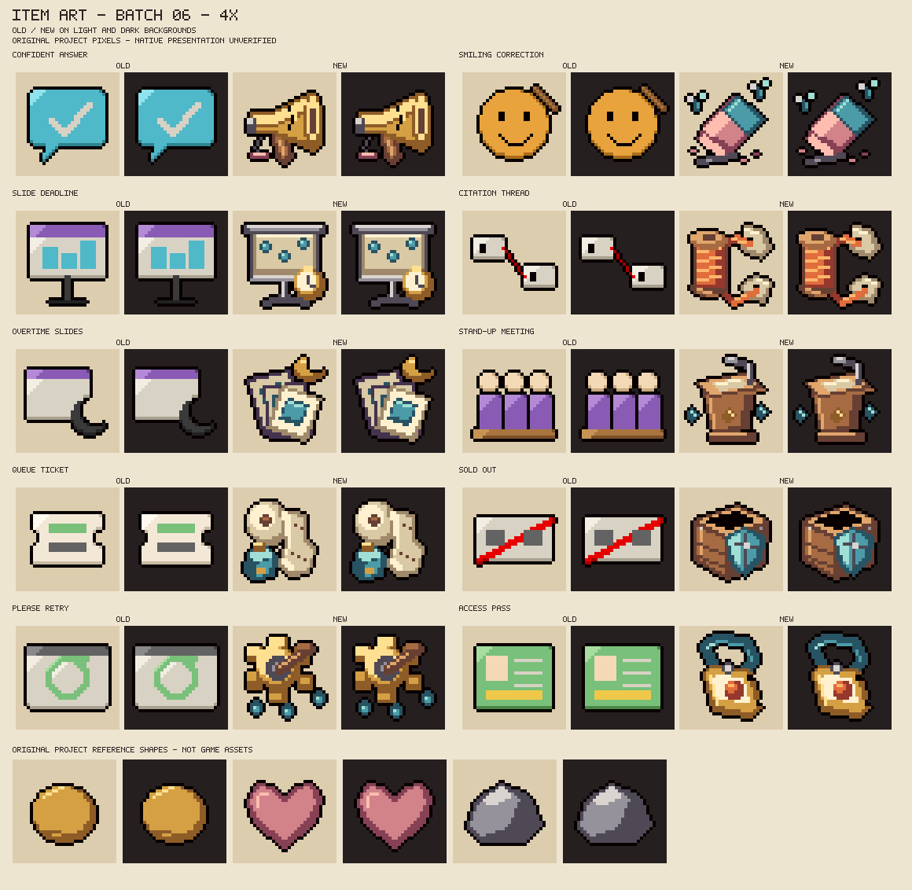

# Sixth batch of designed item icons

W1.3, 2026-10-27. Ten Doubao/Kimi/GLM collectible placeholders are replaced with original 32x32 object drawings. The registry now has **60 designed / 32 placeholder** icons: 58 designed collectibles and two designed trinkets. No item, effect, name, pool or value is added or changed. Native presentation and owner aesthetic acceptance remain pending.

## Review sheets and meaning





The sheets compare old/new art on light and dark fields. Reference coin, heart and stone shapes are original project drawings, not extracted game assets. All lettering stays outside the icons; no official logos, imported pixels or character designs are added.

| Item | Existing effect | Drawing and distinguishing cue |
|---|---|---|
| Confident Answer | Six seconds at +25% damage, then four at -10%; no overlapping cycle. | A brass megaphone with a cracked seam and a flattened squeeze bulb suggests confidence and its weaker aftermath. It does not introduce a projectile weapon. |
| Smiling Correction | After a qualifying enemy hit, a subsequent unique flawless clear grants two blue flies. | A beveled pink eraser with a blue sleeve, rubbed ink and two small flies. No healing cue is used. |
| Slide Deadline | Marks up to three nearby enemies; killing all within eight seconds grants a room damage bonus. | A pull-down screen on a tripod, three blue target dots and a brass timer without numerals. |
| Citation Thread | A hit marks a first reference; attacking another enemy briefly boosts damage against the first. | Orange thread winds around a wooden spool and links two punched paper tags. No text is needed to suggest references. |
| Overtime Slides | Every third unique clear primes slowing outlines on entering the next hostile room. | Three fanned projection transparencies under a brass crescent. The cue indicates late work; it adds no sleep or freezing effect. |
| Stand-Up Meeting | Recalls up to three eligible temporary helpers for bursts at their locations; native familiars are untouched. | A wooden lectern, bent microphone and small blue burst markers. These are object cues, not new helper sprites. |
| Queue Ticket | Every fourth unique combat clear adds one charge to an eligible primary active. | A curled, perforated ticket roll above a small blue battery, without printed numbers. |
| Sold Out | A temporary ordinary-bullet guard and speed bonus; use while guarded keeps charge. | An empty open stock crate protected by a riveted blue shield. The inside remains visibly empty. |
| Please Retry | Fires three delayed native tears along the stored aim, with cancellation on existing lifecycle boundaries. | A brass winding wheel and wooden crank beside three separate blue drops. The tooth silhouette is distinct from a timer. |
| Access Pass | The first observed charged use on a floor grants or banks one combat-room damage benefit. | A punched brass-edged pass on a blue lanyard, with an orange seal and no lettering. It does not unlock doors; F12's completion-observer gap remains open. |

Initial and final 1x/4x sheets were viewed at original resolution. The eraser's initial fly shapes read as drops, so their wings were separated. The initial retry wheel was too round, so the tooth gaps were deepened and top-left highlights added. The transparent-margin validator caught the projection stand's thick feet reaching the canvas boundary; their endpoints were raised one pixel, then both final sheets and deterministic output were checked again. No validator was weakened.

## Reproduction and boundaries

```sh
python tools/preview_item_art.py --write --batch 06
python tools/make_item_art.py --write
python tools/make_item_art.py --check
python tools/preview_item_art.py --check
bash tools/check.sh
```

Exactly ten existing PNGs change against `0bf9fc6`. The other 173 PNGs and all 25 canonical ANM2 files stay unchanged. Two review sheets bring the linked art inventory to 210 files. The other 82 registry records, existing drawing/preview functions, every Lua module/test and XML registration retain their prior content. The shared palette, label alphabet and validator logic are unchanged.

The full gate retains 73 Lua suites, 11 scanner cases, 13 item-art groups and six thumbnail groups, with 190 tracked Lua files, XML/assets/poses, interaction freshness and all twelve review sheets. [Original-item MIT terms](../resources/ART_LICENSE.md) preserve all character credits and non-commercial design conditions. Installed 8fd6a8c stays owner-untried and untouched; no runtime/game/settings/save access occurs. All broad completion rows, native appearance and Workshop authorization remain open.
