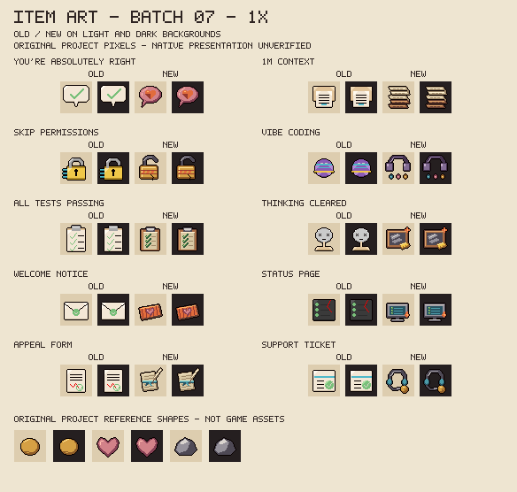
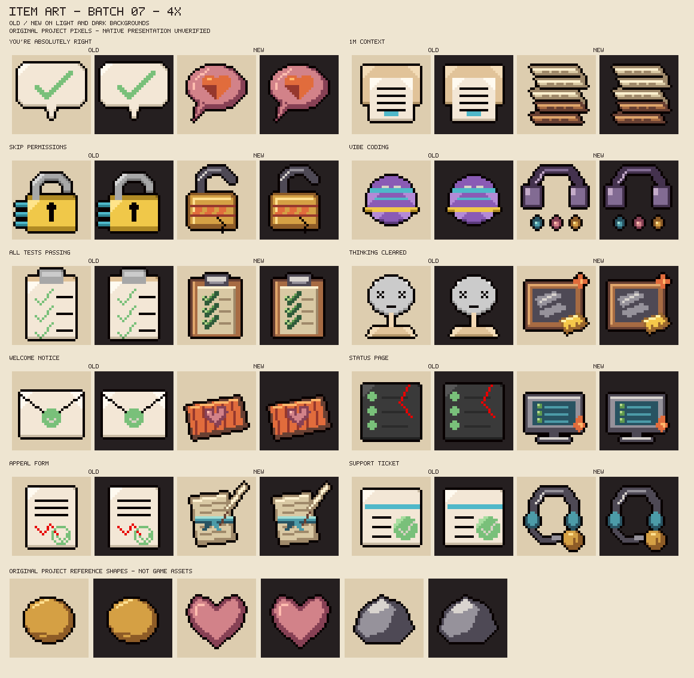

# Seventh batch of designed item icons

W1.3, 2026-10-27. Six Claude-family collectibles and four Claude-family trinkets get original 32x32 object drawings in place of their placeholders. The registry now has **70 designed / 22 placeholder** icons: 64 designed collectibles and six designed trinkets. No item, effect, name, pool or value is added or changed. Native presentation and the owner's aesthetic acceptance are still pending.

## Review sheets and meaning





The sheets compare old and new art on light and dark fields. The coin, heart and stone reference shapes are original project drawings, not extracted game assets. All lettering stays outside the icons. No official logos, imported pixels or character designs are added. One shared green ramp is added for the check marks and status lights; every icon still declares at most 16 colours.

| Item | Existing effect | Drawing and distinguishing cue |
|---|---|---|
| You're Absolutely Right! | Enemies that hurt you are charmed for 5 seconds; you still take the damage. | A pink speech bubble holding a warm orange heart. The bubble shows agreeable words without implying a shield. |
| 1M Context | Range up, but tears lose damage as they fly, down to 30%. | A tall fan-folded printout. The upper pages are fresh paper and the lower pages turn brown, showing long context that degrades over distance. |
| --dangerously-skip-permissions | Locked doors and chests open themselves, with a small chance per room of deleting pickups. | An unlatched brass padlock with an orange hazard band and a crack. No text or command glyphs are drawn. |
| Vibe Coding | Every tear gets a random effect; some tears fly backwards; a coin bill on each floor. | Purple headphones above three differently coloured drops, for random tear effects shipped on feel. |
| All Tests Passing | The room counts as cleared and the doors open, but the enemies remain. | A clipboard with three green ticked rows and blank result lines. The ticks are shapes, not text. |
| Thinking Cleared | Damage up; the active item loses one charge in each new room. | A wiped slate in a wooden frame with a yellow sponge and a small orange spark for the damage. |
| Welcome Notice | The Ban Hammer turns regular enemies into allies instead of banning them. | A woven orange doormat with a stitched pink heart. It says welcome without any lettering. |
| Status Page | Every risk increase is one smaller, but the HUD always says operational. | A monitor showing three healthy green lights while a small flame burns at its corner. |
| Appeal Form | Used up at Suspended; risk drops to 50 instead. | A folded form tied with a blue ribbon beside a quill. The ribbon distinguishes it from the Constitution's wax seal. |
| Support Ticket | Pay 3 coins to lower risk by 20. | A support headset with a boom microphone and a brass coin. It differs from Queue Ticket's ticket roll. |

The first and later drafts were viewed at 8x and in the final 4x sheet. The first 1M Context scroll read as a cigarette, so it became a fan-folded printout with folds alternating at its sides. A loose spark cluttered the padlock shackle and was removed. The headphones and drops first read as a necklace, so the earcups became square and the drops moved into a separate row. Smoke above the monitor merged into a pipe shape and was removed. No validator was weakened.

## Reproduction and boundaries

```sh
python tools/preview_item_art.py --write --batch 07
python tools/make_item_art.py --write
python tools/make_item_art.py --check
python tools/preview_item_art.py --check
bash tools/check.sh
```

Exactly ten existing PNGs change against `11e60ef`. Two review sheets are added. The other 82 registry records, the earlier drawing functions, every Lua module, test and XML registration keep their prior content. The preview label for You're Absolutely Right! omits the exclamation mark because the review-sheet alphabet has no such glyph; the icon itself has no text.

This batch was drawn by Claude, so `design()` gains an optional author argument and these ten records say "Claude-assisted"; every earlier record keeps its author text. The pixels are original project artwork under the [original-item MIT terms](../resources/ART_LICENSE.md), and all character credits and non-commercial design conditions are preserved. The installed build `8fd6a8c` stays untouched; no runtime, game, settings or save access occurred.
