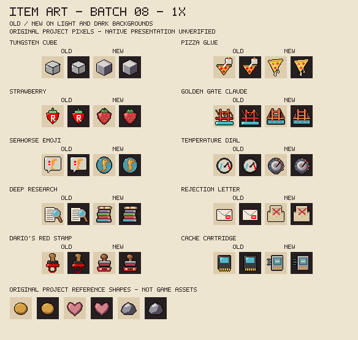
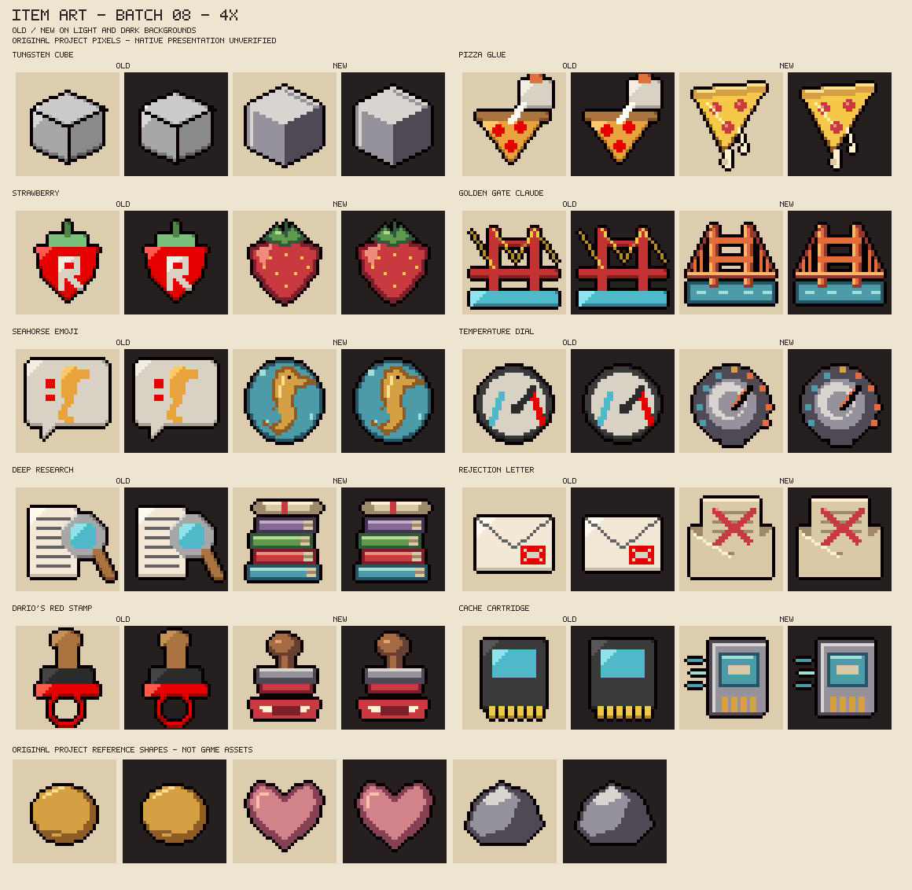

# Eighth batch of designed item icons

W1.3, 2026-10-27. Ten collectibles get original 32x32 object drawings in place of their placeholders. The registry now has **80 designed / 12 placeholder** icons: 74 designed collectibles and six designed trinkets. No item, effect, name, pool or value is added or changed. Native presentation and the owner's aesthetic acceptance are still pending.

## Review sheets and meaning





The sheets compare old and new art on light and dark fields. The coin, heart and stone reference shapes are original project drawings, not extracted game assets. All lettering stays outside the icons, so Strawberry loses its old "R" glyph. No official logos, imported pixels or character designs are added. One shared red ramp is added for fruit, stamps and crossed-out marks; every icon still declares at most 16 colours.

| Item | Existing effect | Drawing and distinguishing cue |
|---|---|---|
| Tungsten Cube | +0.8 damage, -0.15 speed, tears knock enemies back. | A dense grey metal cube with a dark shadow face, heavier than any other steel icon. |
| Pizza Glue | Some tears slow enemies; -0.1 shot speed. | A pizza slice with white glue strands dripping from its tip. |
| Strawberry | Every third tear deals double damage. | A plain strawberry with yellow seeds and a green crown. |
| Golden Gate Claude | Spectral tears, +1.5 range, golden tears. | A generic orange suspension-bridge tower and cables over blue water. It copies no logo or photograph. |
| Seahorse Emoji | Summons a random wisp for the room. | A golden seahorse with a curled tail inside a faint blue wisp bubble. |
| Temperature Dial | Toggles between steady damage and random tear effects. | A round knob whose scale runs from cool blue to hot orange, with the pointer turned towards hot. |
| Deep Research | Reveals the floor map, special and secret rooms. | A tall stack of coloured books topped by a rolled map with a red tie. |
| Rejection Letter | After a hit, clears up to 3 nearby bullets. | An opened envelope holding a letter crossed out in red. |
| Dario's Red Stamp | Stamps an enemy: slowed, no contact damage. | A rubber stamp with a wooden knob above a fresh red mark. It depicts an object, not a person. |
| Cache Cartridge | +0.15 speed in revisited cleared rooms. | A game cartridge with a blank label, gold contacts and speed lines. |

The drafts were viewed at 8x on light and dark fields and in the final 4x sheet. Surface dots made the cube read as a die, so they were removed. A V-shaped inner cable and the crossbars made the bridge read as a face, so the inner cable was removed. Diagonal flap lines cluttered the envelope and were removed. The book stack first exceeded the 16-colour limit, so the map tie reuses the red ramp instead of gold. No validator was weakened.

## Reproduction and boundaries

```sh
python tools/preview_item_art.py --write --batch 08
python tools/make_item_art.py --write
python tools/make_item_art.py --check
python tools/preview_item_art.py --check
bash tools/check.sh
```

Exactly ten existing PNGs change against `50c2337`. Two review sheets are added. The other 82 registry records, the earlier drawing functions, every Lua module, test and XML registration keep their prior content.

These ten records say "Claude-assisted" through the `design()` author argument added in batch 07. The pixels are original project artwork under the [original-item MIT terms](../resources/ART_LICENSE.md), and all character credits and non-commercial design conditions are preserved. The installed build `8fd6a8c` stays untouched; no runtime, game, settings or save access occurred.
