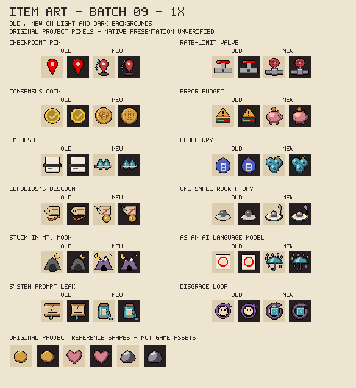
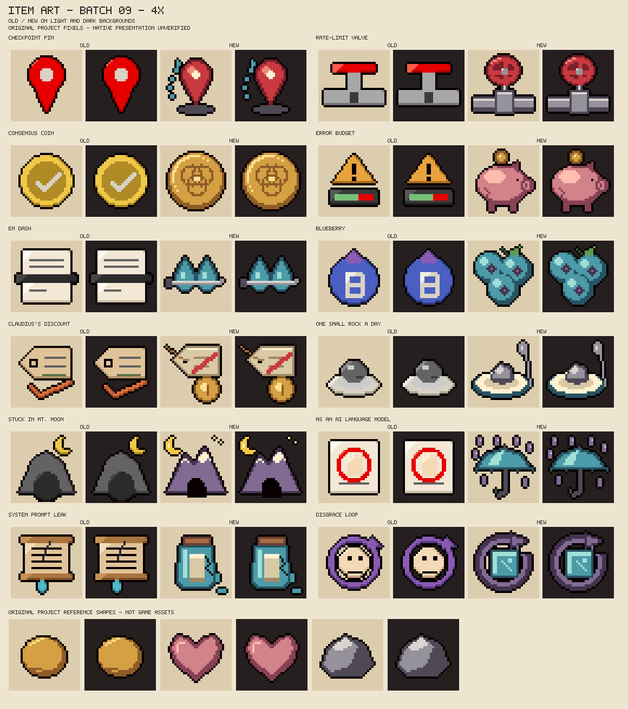

# Ninth batch of designed item icons

W1.3, 2026-10-27. The last six placeholder collectibles and six placeholder trinkets get original 32x32 object drawings. The registry now has **92 designed / 0 placeholder** icons: all 80 collectibles and all 12 trinkets. No item, effect, name, pool or value is added or changed. Native presentation and the owner's aesthetic acceptance are still pending for every batch.

## Review sheets and meaning





The sheets compare old and new art on light and dark fields. The coin, heart and stone reference shapes are original project drawings, not extracted game assets. All lettering stays outside the icons, so Blueberry loses its old "B" glyph and Em Dash is drawn as an object, not a dash glyph. Checkpoint Pin moves away from a familiar map-app marker towards a generic pin in the floor. No official logos, imported pixels or character designs are added, and no new colour ramp is needed.

| Item | Existing effect | Drawing and distinguishing cue |
|---|---|---|
| Checkpoint Pin | Pin your position, then return to it in the same room. | A red map pin pushed into the floor with a dashed return arc. |
| Rate-Limit Valve | After 2 seconds without attacking, the next attack deals +30%. | A steel pipe joint closed by a round red handwheel. |
| Consensus Coin | Two different damage sources on one enemy add a pulse. | A gold coin embossed with three overlapping rings that meet in the middle. |
| Error Budget | The first hit each floor spends the budget for +0.2 speed in that room. | A pink piggy bank with a coin dropping in and a small crack. |
| Em Dash | Piercing tears; +0.16 shot speed. | A long steel needle piercing straight through two blue tears. |
| Blueberry | Every third tear splits into four. | Three dusty blueberries with dark star-shaped crowns. |
| Claudius's Discount | Paid purchases refund 1 coin; each floor costs 1 coin. | A paper price tag on a string, slashed in red, beside a brass coin. |
| One Small Rock a Day | Once per floor, breaking a rock heals half a heart. | One small angular grey rock served on a blue-rimmed plate with a spoon. |
| Stuck in Mt. Moon | Re-entering cleared rooms 6 times maps the floor. | A dark mountain with a cave mouth under a pale crescent moon. It copies no game location art. |
| As an AI Language Model | Refuses and removes one curse each floor. | A blue umbrella deflecting purple curse drops. |
| System Prompt Leak | Reveals the special rooms on each floor. | A cracked glass jar holding a rolled note, leaking a blue drip. |
| Disgrace Loop | The first real hit in a room freezes all enemies for 1.5 seconds. | A pale ice cube ringed by a purple looping arrow. The old face is gone, so the icon depicts no person. |

The drafts were viewed at 8x on light and dark fields and in the final 4x sheet. The first valve wheel's open spokes read as a face, so it became a solid wheel with a recessed centre. Three filled circles merged into one blob on the coin, so they are now drawn as rings. The blueberry crowns were too faint and became darker stars on lighter fruit. The rock first read as a fried egg, so it gained angular facets and the plate gained a blue rim. The validator's transparent-margin rule caught six drafts touching the edge, and each was moved inward. No validator was weakened.

The preview sheet height now follows the batch size, because this batch has twelve records. Earlier ten-record sheets render byte-identically, as `preview_item_art.py --check` confirms.

## Reproduction and boundaries

```sh
python tools/preview_item_art.py --write --batch 09
python tools/make_item_art.py --write
python tools/make_item_art.py --check
python tools/preview_item_art.py --check
bash tools/check.sh
```

Exactly twelve existing PNGs change against `a2e87cf`. Two review sheets are added. The other 80 registry records, the earlier drawing functions, every Lua module, test and XML registration keep their prior content. The legacy placeholder generator stays in place as the source of the "old" review columns.

These twelve records say "Claude-assisted" through the `design()` author argument. The pixels are original project artwork under the [original-item MIT terms](../resources/ART_LICENSE.md), and all character credits and non-commercial design conditions are preserved. The installed build `8fd6a8c` stays untouched; no runtime, game, settings or save access occurred.
